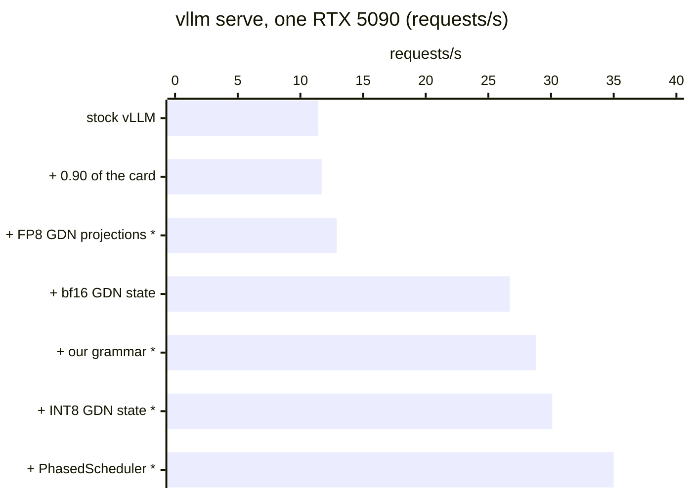
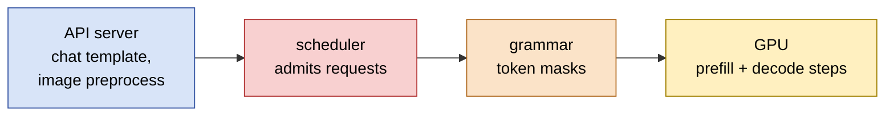

# KohakuvLLM

Faster serving of small hybrid VLMs (Qwen3.5: Gated DeltaNet + full attention, with a vision
tower) on [vLLM](https://github.com/vllm-project/vllm): our own scheduler, JSON grammar, 8-bit
GDN state and quantizer, as a plugin package beside a stock vLLM wheel. Nothing is forked,
patched on disk or recompiled; with no option set, vLLM runs as shipped. [TESTED.md](TESTED.md)
names the vLLM versions each part was verified on.

## Speed

**11.4 -> 35.0 requests/s (3.1x) on one RTX 5090**, `vllm serve` alone: Qwen3.5-4B (8-bit
weights), 1724 recorded captioning requests (one image and one JSON schema each, about 1000
prompt tokens, 100 reply tokens), 512 in flight. Every reply is schema-valid JSON at every step.



Each step adds one change to the one before (`*`: KohakuvLLM):

| Step | req/s | Gain | Bottleneck after it |
|---|---|---|---|
| stock vLLM (0.55 of the card, 256 seqs, xgrammar) | 11.4 | | scheduler |
| + 0.90 of the card, 384 seqs | 11.7 | +2% | scheduler |
| + FP8 GDN projections * | 12.9 | +11% | scheduler |
| + bf16 GDN state (vLLM option) | **26.7** | **x2.1** | grammar |
| + our grammar, replacing xgrammar * | 28.8 | +8% | GPU |
| + INT8 GDN state * | 30.1 | +5% | GPU |
| + `PhasedScheduler` * | **35.0** | **+16%** | API server |

Mean of four cards. Time to first token (p50): 37 s stock, 4.8 s with the bf16 state, 9.6 s at
the end (`PhasedScheduler` holds prefills back to keep decode steps whole).

## Where the bottleneck is



1. **Stock vLLM: the scheduler** (red). About 85 sequences run while about 410 requests sit
   deferred, with the KV cache 30-80% used. vLLM's bf16 GDN state lifts it to about 380
   running: x2.1.
2. **Then xgrammar** (orange). It still defers about 120 requests in the scheduler. Our grammar
   builds masks on the worker and defers none: +8%.
3. **Then the GPU** (yellow). Steps mixing prefill and decode run piecewise; `PhasedScheduler`
   keeps most steps decode-only, so they replay full CUDA graphs: +16%. (With xgrammar it
   costs 22% instead: its decode-only steps sit behind the deferred requests.)
4. **Last: vLLM's API server** (blue). At 35 requests/s the engine has under 60 requests
   waiting while 512 are in flight; the server's event loop stalls for up to 2.6 s. Alone on a
   card the full stack runs at 33-46 requests/s depending on those stalls.

## Grammar: faster and more accurate than xgrammar

| | KohakuvLLM grammar | xgrammar |
|---|---|---|
| mask decisions judged wrong (of 7.35M) | **0** | 5.7M |
| valid documents rejected | **0** | 163 |
| cost per step | 0.005 ms (memo); 0.07-0.10 ms per new mask | 0.6-0.75 ms |
| scheduler | nothing deferred | ~120 requests deferred |
| replay above, same reply lengths | **28.8 req/s** | 26.7 req/s |

Every step along generated documents and random walks of seven JSON schemas is compared over the
whole vocabulary; an independent judge (`bench/grammar/reference.py`) decides each disagreement
and a sample of the agreements. xgrammar forbids escapes and allows raw control bytes in
`maxLength` strings.

Allow whitespace (`KOHAKU_GRAMMAR_WS`, default 8 bytes per gap): forced into compact JSON,
Qwen3.5 runs 5-10% of some replies to `max_tokens`, with xgrammar as with ours. With whitespace
allowed, none.

## Install and serve

```bash
pip install kohakuvllm            # beside vLLM; or pip install -e . from a clone
pip install ./grammar             # the Rust grammar matcher (needs maturin and a Rust toolchain)
```

```bash
KOHAKU_GDN_STATE=int8 KOHAKU_PREFILL_EVERY=16 VLLM_HTTP_TIMEOUT_KEEP_ALIVE=60 \
vllm serve Qwen/Qwen3.5-4B \
    --mamba-ssm-cache-dtype bfloat16 \
    --scheduler-cls kohakuvllm.sched.PhasedScheduler \
    --logits-processors kohakuvllm.grammar:JsonSchemaLogits
```

A request asks for its JSON schema in `vllm_xargs`:

```json
{"model": "...", "messages": [...], "vllm_xargs": {"kohaku_json_schema": "{\"type\": \"object\", ...}"}}
```

In-process (`AsyncLLM`), the same parts are engine arguments (`scheduler_cls=`,
`logits_processors=`) and `SamplingParams(extra_args={"kohaku_json_schema": ...})`.

`VLLM_HTTP_TIMEOUT_KEEP_ALIVE` above uvicorn's 5 s: when the API server stalls, an expired
keep-alive closes a connection a request was just sent on, and that request gets no response
(4 of 5172 at 5 s; 0 at 300 s). Or let the client expire idle connections sooner, e.g.
`httpx.Limits(keepalive_expiry=2)` (0 of 5172).

## The parts

| Part | Turn on | Gain |
|---|---|---|
| [`PhasedScheduler`](#phasedscheduler) | `--scheduler-cls` | +16% |
| [`grammar`](#grammar) | `--logits-processors` | +8% vs xgrammar |
| [`gdn.state8`](#gdnstate8) | `KOHAKU_GDN_STATE` | +5% |
| [`tools/quantize.py`](#tools) | an FP8-GDN checkpoint | +11% |
| [`front`](#front) | in-process | off by default |
| [`gdn.hybrid`](#gdnhybrid) | `KOHAKU_GDN=hybrid` | off by default |

`kohakuvllm.plugin` is the `vllm.general_plugins` entry point: it warns once when vLLM is newer
than `TESTED_VLLM` and installs `gdn.state8` or `gdn.hybrid` when their variables ask for them.

### PhasedScheduler

Subclasses vLLM's `AsyncScheduler`. Between prefill steps it calls vLLM's own prefill throttle
with the saturation escape off, so those steps are uniform decode batches that replay full CUDA
graphs.

- `KOHAKU_PREFILL_EVERY` (4): one step in that many admits prefill; 1 is vLLM's own scheduling.
- Use it with our grammar: with xgrammar it costs 22%. Under a saturated offline queue of
  uniform text prompts it also costs (17.8 -> 14.8 requests/s): there, batching prefill wins.

### grammar

A vLLM v1 logits processor over the Rust matcher in `grammar/` (`kohakuvllm-grammar`).

- Byte-level JSON for object, array, string with lengths, number, boolean, null and enum. Its
  counters clamp to the longest token, so each distinct state's mask is built once (a token-trie
  walk) and copied once to a GPU table.
- A step is one Rust call for the batch and one mask id per row; one Triton kernel masks the
  logits. The last tokens are read on the worker, so nothing waits in the scheduler.
- `KOHAKU_GRAMMAR_WS` (8): whitespace bytes allowed per gap; 0 is compact JSON.

### gdn.state8

The GDN recurrent state in 8 bits with a float32 scale per row: half the bytes of the bf16 state,
11% more KV tokens in the same memory.

- `KOHAKU_GDN_STATE=int8` or `fp8` (FP8 needs sm89+); `KOHAKU_GDN_STATE_TILE=ROWSxWARPS` (8x1).
- Decodes run one Triton kernel that dequantizes, steps and requantizes each row; prefills
  dequantize before vLLM's chunked kernel and quantize its final states.
- Error against an fp64 ruler over 64 decode steps, per state row: bf16 0.17%, INT8 0.64%, FP8
  2.7%, no growth over steps. Replies stay valid at the same lengths.
- Pays most where the KV cache is the limit. Not with `gdn.hybrid` or speculative decoding.

### front

Feeds vLLM's `enable_mm_embeds` path: chat template and image processor in a pool of worker
processes, the model's own vision tower (bf16, or FP8 linears on sm89+) on its own CUDA stream.
Prompt ids are identical to vLLM's path. Off by default: on a busy host it was slower than
vLLM's own input path. `Frontend(llm, model)` around an `AsyncLLM`.

### gdn.hybrid

`KOHAKU_GDN=hybrid` runs the GDN core of mixed steps as one fixed launch sequence (our Triton
varlen conv, FLA's recurrent decode, FlashInfer's chunked prefill) so piecewise CUDA graphs
capture it. Each piece matches vLLM's within the fp32 reference's error and is faster per layer
(0.18-0.58 vs 0.43-0.93 ms), but end to end it does not gain on a power-bound card.
`KOHAKU_GDN=check` runs it beside vLLM's core and logs the difference per layer and step.

## Tools

| Path | What it is |
|---|---|
| `tools/quantize.py` | W8A8 checkpoints (FP8 or INT8), GDN projections included |
| `tools/smooth.py` | SmoothQuant folded into Qwen3.5's RMSNorms |
| `tools/gptq_w8a8.py` | GPTQ W8A8 through llm-compressor |

## Benchmarks

| Path | Measures |
|---|---|
| `bench/inproc/run.py` | the engine alone, in-process |
| `bench/profile/` | Nsight capture; GPU busy, gaps, kernel classes |
| `bench/gdn/` | each GDN piece vs vLLM's and an fp64 ruler |
| `bench/front/check.py` | the frontend vs vLLM's input path |
| `bench/grammar/` | our masks vs xgrammar's, with an independent judge |
| `bench/precision/` | two engine configs: KL, argmax agreement |

## License

Apache-2.0.
