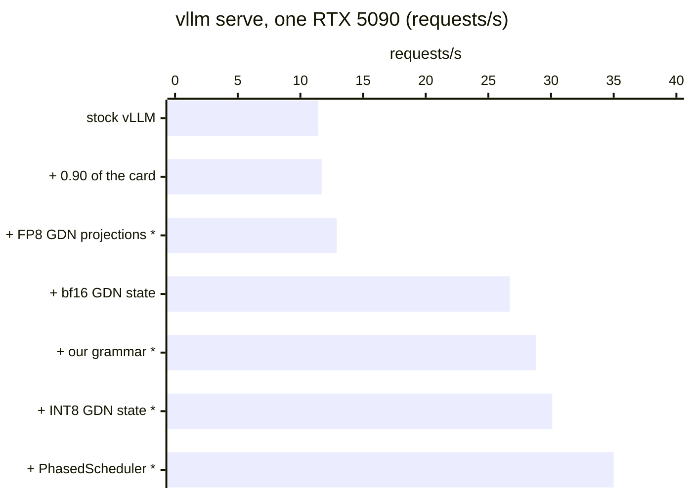
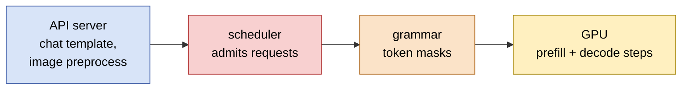

# KohakuvLLM

A [vLLM](https://github.com/vllm-project/vllm) plugin that makes `vllm serve` faster on small
hybrid VLMs (Qwen3.5: Gated DeltaNet + full attention, with a vision tower): our scheduler, KV
allocation shortcut, JSON grammar, 8-bit GDN state and NVFP4 kernels, plus a quantizer. Install
it beside a stock vLLM wheel and set `KOHAKU_VLLM=1`. Nothing is forked, patched on disk or
recompiled; with `KOHAKU_VLLM` unset, vLLM runs as shipped. [TESTED.md](TESTED.md)
names the vLLM versions each part was verified on. To use it, follow the
[tutorial](#tutorial-serve-qwen35-4b-with-everything-on).

## Speed

**11.4 -> 35.0 requests/s (3.1x) on one RTX 5090**, `vllm serve` alone: Qwen3.5-4B (8-bit
weights), 1724 recorded captioning requests (one image and one JSON schema each, about 1000
prompt tokens, 100 reply tokens), 512 in flight. Every reply is schema-valid JSON at every step.



Each step adds one change to the one before (`*`: KohakuvLLM):

| Step | req/s | Gain | Bottleneck after it |
|---|---|---|---|
| stock vLLM (0.55 of the card, 256 seqs, xgrammar) | 11.4 | | scheduler |
| + 0.90 of the card, 384 seqs | 11.7 | +2% | scheduler |
| + FP8 GDN projections * | 12.9 | +11% | scheduler |
| + bf16 GDN state (vLLM option) | **26.7** | **x2.1** | grammar |
| + our grammar, replacing xgrammar * | 28.8 | +8% | GPU |
| + INT8 GDN state * | 30.1 | +5% | GPU |
| + `PhasedScheduler` * | **35.0** | **+16%** | API server |

Mean of four cards. Time to first token (p50): 37 s stock, 4.8 s with the bf16 state, 9.6 s at
the end (`PhasedScheduler` holds prefills back to keep decode steps whole).

## Where the bottleneck is



1. **Stock vLLM: the scheduler** (red). About 85 sequences run while about 410 requests sit
   deferred, with the KV cache 30-80% used. vLLM's bf16 GDN state lifts it to about 380
   running: x2.1.
2. **Then xgrammar** (orange). It still defers about 120 requests in the scheduler. Our grammar
   builds masks on the worker and defers none: +8%.
3. **Then the GPU** (yellow). Steps mixing prefill and decode run piecewise; `PhasedScheduler`
   keeps most steps decode-only, so they replay full CUDA graphs: +16%. (With xgrammar it
   costs 22% instead: its decode-only steps sit behind the deferred requests.)
4. **Last: vLLM's API server** (blue). At 35 requests/s the engine has under 60 requests
   waiting while 512 are in flight; the server's event loop stalls for up to 2.6 s. Alone on a
   card the full stack runs at 33-46 requests/s depending on those stalls.

## Grammar: faster and more accurate than xgrammar

| | KohakuvLLM grammar | xgrammar |
|---|---|---|
| mask decisions judged wrong (of 7.35M) | **0** | 5.7M |
| valid documents rejected | **0** | 163 |
| cost per step | 0.005 ms (memo); 0.07-0.10 ms per new mask | 0.6-0.75 ms |
| scheduler | nothing deferred | ~120 requests deferred |
| replay above, same reply lengths | **28.8 req/s** | 26.7 req/s |

Every step along generated documents and random walks of seven JSON schemas is compared over the
whole vocabulary; an independent judge (`bench/grammar/reference.py`) decides each disagreement
and a sample of the agreements. xgrammar forbids escapes and allows raw control bytes in
`maxLength` strings.

Allow whitespace (`KOHAKU_GRAMMAR_WS`, default 8 bytes per gap): forced into compact JSON,
Qwen3.5 runs 5-10% of some replies to `max_tokens`, with xgrammar as with ours. With whitespace
allowed, none.

## Tutorial: serve Qwen3.5-4B with everything on

### 1. Install

KohakuvLLM is installed from this repository (it is not on PyPI), into the environment that
already has vLLM (`pip install vllm`, see [TESTED.md](TESTED.md) for the version).

```bash
git clone https://github.com/KohakuBlueleaf/KohakuvLLM
cd KohakuvLLM
pip install -e .                  # the plugin (vLLM loads it by itself)
pip install maturin
pip install ./grammar             # the Rust grammar matcher (needs a Rust toolchain: rustup.rs)
```

Check both halves: `python -c "import kohakuvllm, kohakuvllm_grammar"`.

### 2. Make the FP8-GDN checkpoint (optional, +11%)

Start from the FP8 checkpoint and quantize the GDN projections it leaves in BF16:

```bash
huggingface-cli download RedHatAI/Qwen3.5-4B-FP8-dynamic --local-dir qwen35-4b-fp8
python tools/quantize.py qwen35-4b-fp8 qwen35-4b-fp8-gdn --scheme fp8 \
    --suffixes linear_attn.in_proj_qkv.weight linear_attn.in_proj_z.weight \
    linear_attn.out_proj.weight
```

`qwen35-4b-fp8-gdn` is a normal compressed-tensors checkpoint; any vLLM loads it. Skip this step
to serve `qwen35-4b-fp8` (or the BF16 `Qwen/Qwen3.5-4B`) instead.

### 3. Serve

```bash
KOHAKU_VLLM=1 VLLM_HTTP_TIMEOUT_KEEP_ALIVE=60 \
vllm serve qwen35-4b-fp8-gdn --served-model-name qwen3.5-4b \
    --gpu-memory-utilization 0.90 --max-num-seqs 384 --max-model-len 8192 \
    --limit-mm-per-prompt '{"image": 1}' \
    --mamba-ssm-cache-dtype bfloat16
```

The package is a vLLM plugin: installed, `vllm serve` loads it in every process, with no class
path flag. `KOHAKU_VLLM` is the one switch (unset: vLLM runs as shipped):

| `KOHAKU_VLLM` item | Part |
|---|---|
| `1` | the default set: `sched,alloc,state,nvfp4` |
| `sched=16` | `PhasedScheduler`, one step in 16 admits prefill (4 by default) |
| `alloc` | the `allocate_slots` shortcut |
| `state=int8` | the 8-bit GDN state (`fp8` on sm89+) |
| `nvfp4` | our NVFP4 producers (NVFP4 checkpoints only) |
| `-alloc` | drops a part of the default set (`KOHAKU_VLLM=1,-alloc`) |

The JSON grammar needs no switch: a request that carries a schema gets it, the others never touch
it. Other vLLM options worth setting:

| Option | Part |
|---|---|
| `--mamba-ssm-cache-dtype bfloat16` | vLLM's own bf16 GDN state (the x2.1 step) |
| `VLLM_HTTP_TIMEOUT_KEEP_ALIVE=60` | no dropped requests when the API server stalls |

The keep-alive: when vLLM's API server stalls (up to 2.6 s at full load), uvicorn's 5 s
keep-alive closes connections a request was just sent on, and that request gets no response
(4 of 5172 requests at 5 s, 0 at 300 s). A client can also expire its idle connections sooner,
e.g. `httpx.Limits(keepalive_expiry=2)` (0 of 5172).

### 4. Ask for JSON

The schema goes in `vllm_xargs` as text (not in `response_format`, which is xgrammar's):

```python
import base64, json
from openai import OpenAI

client = OpenAI(base_url="http://127.0.0.1:8000/v1", api_key="none")
schema = {
    "type": "object",
    "properties": {
        "caption": {"type": "string", "minLength": 1, "maxLength": 400},
        "objects": {"type": "array", "maxItems": 8, "items": {"type": "string"}},
    },
    "required": ["caption", "objects"],
}
image = base64.b64encode(open("cat.jpg", "rb").read()).decode()
reply = client.chat.completions.create(
    model="qwen3.5-4b",
    messages=[{"role": "user", "content": [
        {"type": "image_url", "image_url": {"url": f"data:image/jpeg;base64,{image}"}},
        {"type": "text", "text": "Describe the image as JSON."},
    ]}],
    max_tokens=512,
    extra_body={
        "vllm_xargs": {"kohaku_json_schema": json.dumps(schema)},
        "chat_template_kwargs": {"enable_thinking": False},
    },
)
print(json.loads(reply.choices[0].message.content))
```

Supported schema keywords: `object` (`properties`, `required`; keys in schema order), `array`
(`items`, `minItems`, `maxItems`), `string` (`minLength`, `maxLength`), `integer`, `number`,
`boolean`, `null`, `enum`, `const`. Any other type is rejected with an error; other keywords
(`pattern`, `format`, ...) are not enforced.

### 5. Or in-process

```python
import json
from vllm import LLM, SamplingParams

llm = LLM("qwen35-4b-fp8-gdn", mamba_ssm_cache_dtype="bfloat16")
params = SamplingParams(max_tokens=512, extra_args={"kohaku_json_schema": json.dumps(schema)})
```

with `KOHAKU_VLLM=1` in the environment, as above.

## The parts

| Part | `KOHAKU_VLLM` | Gain |
|---|---|---|
| [`sched`](#sched) | `sched[=N]` | +16% (RTX 5090), +8% at N=16 (B300) |
| [`alloc`](#alloc) | `alloc` | +9% (B300, Qwen3.5-9B NVFP4) |
| [`grammar`](#grammar) | none (per request) | +8% vs xgrammar |
| [`gdn.state8`](#gdnstate8) | `state=int8` | +5% |
| [`nvfp4`](#nvfp4) | `nvfp4`, `lmhead=fp8` | NVFP4 checkpoints |
| [`kernels`](#kernels) | (used by the parts) | |
| [`tools/quantize.py`](#tools) | an FP8-GDN checkpoint | +11% |

`kohakuvllm.plugin` is the `vllm.general_plugins` entry point: it warns once when vLLM is newer
than `TESTED_VLLM` and installs the parts `KOHAKU_VLLM` names (`kohakuvllm.features`). The
variables before it (`KOHAKU_PREFILL_EVERY`, `KOHAKU_GDN_STATE`, `KOHAKU_NVFP4`,
`KOHAKU_FAST_ALLOC`, `KOHAKU_GRAMMAR_WS`) still work, with a warning.

### sched

`PhasedScheduler` subclasses vLLM's `AsyncScheduler` and becomes vLLM's scheduler when no
`--scheduler-cls` is given. Between prefill steps it calls vLLM's own prefill throttle with the
saturation escape off, so those steps are uniform decode batches that replay full CUDA graphs.

- `sched=N` (4): one step in N admits prefill; 1 is vLLM's own scheduling. On a B300 with
  Qwen3.5-9B NVFP4, 16 beats 4 (92.7 vs 85.8 requests/s).
- Use it with our grammar: with xgrammar it costs 22%. Under a saturated offline queue of
  uniform text prompts it also costs (17.8 -> 14.8 requests/s): there, batching prefill wins.

### alloc

vLLM's `KVCacheManager.allocate_slots` runs for every scheduled request every step and walks
every KV cache group in Python. On a hybrid model at a thousand running requests that walk was
a fifth of the engine core's time. A running request whose new tokens stay inside blocks it
already holds, in every group, gets nothing from it, and `alloc` returns vLLM's empty result for
those directly. `alloc=check` runs vLLM's code as well and counts any call where it changed a
block: 0 of 600k on Qwen3.5-9B NVFP4, where 96% of calls take the shortcut. B300, the same
replay with `sched=16,state=int8`: 90.7 -> 99.2 requests/s.

### On a B300

`vllm serve` alone on recorded captioning requests (Qwen3.5-9B NVFP4, 6144 requests, 1024 in
flight; one run each, so a few percent is noise):

| `KOHAKU_VLLM` | requests/s |
|---|---|
| `sched=16,state=int8` | 90.7 |
| `sched=16,state=int8,alloc` | 99.2 |
| `1,sched=16` | 100.9 |
| `1,sched=16,-state` | 97.3 |
| (unset: vLLM as shipped, grammar per request) | 103.6 |

The card stays under half busy in all of them: the engine's single Python loop is the limit, not
the GPU. The replay is not the whole story: under a full captioning pipeline (two engines beside
the detector on the same card), `sched=4,state=int8` serves 39.7 requests/s against 34.3 for
vLLM as shipped, so measure on your own workload.

### grammar

A vLLM logits processor (Model Runner V2) over the Rust matcher in `grammar/`
(`kohakuvllm-grammar`), registered as a `vllm.logits_processors` plugin.

- Byte-level JSON for object, array, string with lengths, number, boolean, null and enum. Its
  counters clamp to the longest token, so each distinct state's mask is built once (a token-trie
  walk) and copied once to a GPU table.
- A step is one Rust call for the batch and one mask id per row; one kernel (`grammar_mask`)
  masks the logits. The last tokens are read on the worker, so nothing waits in the scheduler.
- `grammar_ws=N` (8): whitespace bytes allowed per gap; 0 is compact JSON.
- Also given by `--logits-processors kohakuvllm.grammar:JsonSchemaLogits` (older setups): the
  second instance stays inert.

### gdn.state8

The GDN recurrent state in 8 bits with a float32 scale per row: half the bytes of the bf16 state,
11% more KV tokens in the same memory.

- `state=int8` or `fp8` (FP8 needs sm89+).
- Decodes run `gdn_state8_decode`, which dequantizes, steps and requantizes each row; prefills
  dequantize before vLLM's chunked kernel and quantize its final states.
- Error against an fp64 ruler over 64 decode steps, per state row: bf16 0.17%, INT8 0.64%, FP8
  2.7%, no growth over steps. Replies stay valid at the same lengths.
- Pays most where the KV cache is the limit. Not with speculative decoding.

### nvfp4

On NVFP4 checkpoints (sm100 / sm120), a torch.compile pass puts our producers
(`nvfp4_quant`, and `rmsnorm_nvfp4` with the RMSNorm fused into the quantizations it feeds) in
place of vLLM's; byte for byte vLLM's `scaled_fp4_quant`. `lmhead=fp8` or `nvfp4` quantizes the
LM head too.

### kernels

`kohakuvllm.kernels` is an op registry. Each op has an eager reference and per-arch kernels; a
caller resolves an op once and falls back along the arch's priority (sm10x: Gluon, Triton,
eager; sm80-sm90 and sm12x: Triton, eager) when a backend cannot build or launch. A kernel
written for one card serves every card that can run it. `python bench/kernels/check.py` checks every
backend against the eager reference on the card it runs on.

| Op | Backends |
|---|---|
| `nvfp4_quant`, `rmsnorm_nvfp4` | Triton, eager (vLLM's ops) |
| `grammar_mask` | Triton, eager |
| `gdn_state8_decode` | Triton, eager |

## Tools

| Path | What it is |
|---|---|
| `tools/quantize.py` | W8A8 checkpoints (FP8 or INT8), GDN projections included |
| `tools/smooth.py` | SmoothQuant folded into Qwen3.5's RMSNorms |
| `tools/gptq_w8a8.py` | GPTQ W8A8 through llm-compressor |

## Benchmarks

| Path | Measures |
|---|---|
| `bench/kernels/check.py` | every kernel backend against its eager reference, on this card |
| `bench/inproc/run.py` | the engine alone, in-process |
| `bench/profile/` | Nsight capture; GPU busy, gaps, kernel classes |
| `bench/gdn/` | the 8-bit GDN state vs an fp64 ruler, decode speed per tile |
| `bench/grammar/` | our masks vs xgrammar's, with an independent judge |
| `bench/precision/` | two engine configs: KL, argmax agreement |

## License

Apache-2.0.
