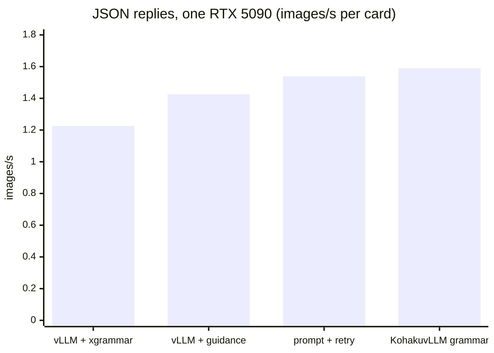
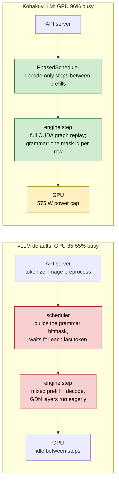

# KohakuvLLM

Our own scheduler, grammar and kernels for running small hybrid VLMs (Qwen3.5: Gated DeltaNet +
full attention, with a vision tower) at full GPU load, with
[vLLM](https://github.com/vllm-project/vllm)'s engine as the backend.

It is a drop-in plugin package: install it beside a stock vLLM wheel. Nothing is forked, patched
on disk or recompiled, and with no option set vLLM runs as shipped. It follows upstream vLLM;
[TESTED.md](TESTED.md) names the last versions each part was verified on.

## At a glance

**12.7 -> 23.2 requests/s (1.8x)** on one RTX 5090: Qwen3.5-4B behind `vllm serve` with real
captioning requests (an image and a JSON schema each), vLLM's defaults against KohakuvLLM's
configuration. The 12.7 had the card to itself; the 23.2 shares it with SAM 3 and
EmbeddingGemma.

With every vLLM setting the same on both sides: one RTX 5090, Qwen3.5-4B (8-bit weights),
[KohakuGBC](https://github.com/KohakuBlueleaf/KohakuGBC)'s captioning machine (VLM + SAM 3 +
EmbeddingGemma on the card), real captioning requests:

| | stock vLLM | with KohakuvLLM |
|---|---|---|
| VLM requests/s, behind `vllm serve` | **19.8** | **23.2** (+17%) |
| images/s, behind `vllm serve` | 1.445 | **1.695** |
| images/s, engine in-process | 1.418 | **1.653** |

Same machine settings for both columns (0.75 of the card, 384 sequences, the same checkpoint),
one window, each cell on its own card; stock vLLM gets its JSON by prompt and one retry. Four cards, one machine each: **6.46 images/s** for the
box.

From the first measurement to the final configuration, step by step:

| Step | img/s per card | Change |
|---|---|---|
| stock vLLM, 0.55 of the card | 0.95 | |
| + `PhasedScheduler` | 1.36 | **+43%** |
| + 0.75 of the card, 384 sequences | 1.50-1.55 | +12% (vLLM settings) |
| + Rust JSON grammar (vs xgrammar) | 1.589 (vs 1.226) | **+30%** |
| + 8-bit GDN state | 1.59-1.65 | +2% (5090), +9% (3090) |

The engine alone, synthetic 1000 tokens in / 100 out, in-process:

| Step | requests/s |
|---|---|
| stock vLLM, `RedHatAI/Qwen3.5-4B-FP8-dynamic` | 17.8 |
| + GDN projections in FP8 (`tools/quantize.py`) | +19% |
| + bf16 GDN state (vLLM's `mamba_ssm_cache_dtype`) | +27% |
| **= together** | **26.9** (1.5x) |



## Where the time goes

With vLLM's defaults behind `vllm serve` and a JSON schema per request (12.7 requests/s on this
card), the GPU waits on the engine's host thread. KohakuvLLM moves that work off the thread and
keeps the steps graph-replayed until the GPU itself, at its power cap, is the limit.



- **Stock bottleneck 1, mixed steps.** A step that holds both prefill and decode runs piecewise:
  the GDN layers launch about 460 kernels per step eagerly, and the GPU waits for the host.
- **Stock bottleneck 2, the grammar bitmask.** vLLM builds it in the scheduler, which has to
  wait for each request's last token. Under async scheduling about 250 requests stay "Deferred"
  and the card idles (74.8% busy with xgrammar).
- **Tuned stock vLLM keeps the card busy, on slower work.** With the share and sequences raised,
  stock vLLM also fills the GPU (98.8% busy), but its mixed steps send decode attention down the
  split-KV path: 12.0% of GPU time, against 3.1% when `PhasedScheduler` keeps decodes in their
  own steps, the largest difference between the two profiles.
- **KohakuvLLM's limit is the card.** At 96% busy and 545-575 W, the GPU time is FP8 GEMMs
  (about half), attention (14%) and the GDN decode; SAM 3 and EmbeddingGemma share the card.

## Install

```bash
pip install kohakuvllm            # beside vLLM; or pip install -e . from a clone
pip install ./grammar             # the Rust grammar matcher (needs maturin and a Rust toolchain)
```

Serve with the scheduler, the grammar and the 8-bit GDN state:

```bash
KOHAKU_GDN_STATE=int8 KOHAKU_PREFILL_EVERY=16 vllm serve Qwen/Qwen3.5-4B \
    --scheduler-cls kohakuvllm.sched.PhasedScheduler \
    --logits-processors kohakuvllm.grammar:JsonSchemaLogits
```

A request then asks for its JSON schema in `vllm_xargs`:

```json
{"model": "...", "messages": [...], "vllm_xargs": {"kohaku_json_schema": "{\"type\": \"object\", ...}"}}
```

In-process (`AsyncLLM`), the same parts are engine arguments (`scheduler_cls=`,
`logits_processors=`) and `SamplingParams(extra_args={"kohaku_json_schema": ...})`.

## The parts

| Part | Turn on | Effect |
|---|---|---|
| [`PhasedScheduler`](#phasedscheduler) | `--scheduler-cls` | +43% img/s |
| [`grammar`](#grammar) | `--logits-processors` | +30% vs xgrammar |
| [`gdn.state8`](#gdnstate8) | `KOHAKU_GDN_STATE` | +2% (5090), +9% (3090) |
| [`tools/quantize.py`](#tools) | an FP8 checkpoint | +19% requests/s |
| [`front`](#front) | in-process only | off: slower here |
| [`gdn.hybrid`](#gdnhybrid) | `KOHAKU_GDN=hybrid` | off: no gain |

`kohakuvllm.plugin` is the `vllm.general_plugins` entry point. It runs at import in every vLLM
process, warns once when vLLM is newer than `TESTED_VLLM`, and installs `gdn.state8` or
`gdn.hybrid` when their variables ask for them. Nothing else in vLLM is touched.

### PhasedScheduler

`kohakuvllm.sched.PhasedScheduler` subclasses vLLM's `AsyncScheduler` (loaded by the
`scheduler_cls` engine argument). Between prefill steps it calls vLLM's own prefill throttle
with the saturation escape off, so those steps are uniform decode batches that replay full CUDA
graphs.

- `KOHAKU_PREFILL_EVERY` (4): one step in that many admits prefill; 1 is vLLM's own scheduling.
  16 is best on the captioning machine; 4 / 8 / 32 are within 3%.
- Under a saturated offline queue of uniform prompts it costs (17.8 -> 14.8 requests/s):
  there, batching prefill wins.

### grammar

`kohakuvllm.grammar:JsonSchemaLogits` is a vLLM v1 logits processor; the matcher is the Rust
package in `grammar/` (`kohakuvllm-grammar`).

- A byte-level matcher for object, array, string with lengths, number, boolean, null and enum.
  Its counters clamp to the longest token, so each distinct clamped state's mask is built once
  (a token-trie walk) and copied once to a GPU table.
- A step costs one Rust call for the batch and one mask id per row; one Triton kernel masks the
  logits. The last tokens are read on the worker, so nothing waits in the scheduler.
- Cost: 0.005 ms per step from the memo, 0.07-0.10 ms per new mask; xgrammar fills a mask in
  0.6-0.75 ms.
- Correctness: on GBC's seven schemas, every step over the whole vocabulary was compared with
  xgrammar, an independent judge deciding each disagreement (7.35M decisions). Ours: 0 wrong.
  xgrammar: 5.7M wrong (it forbids escapes and allows raw control bytes in `maxLength` strings)
  and 163 valid documents rejected. In the engine, 231 / 231 replies were valid.
- `KOHAKU_GRAMMAR_WS`: whitespace allowed per gap (0).

### gdn.state8

The GDN recurrent state in 8 bits with a float32 scale per row: half the state bytes, so the same
cache holds 11% more KV tokens.

- `KOHAKU_GDN_STATE=int8` or `fp8` (FP8 needs sm89+); `KOHAKU_GDN_STATE_TILE=ROWSxWARPS` (8x1).
- Decodes run one Triton kernel that dequantizes, steps and requantizes each row; prefills
  dequantize before vLLM's chunked kernel and quantize its final states.
- Error against an fp64 ruler over 64 decode steps, per state row: bf16 pool 0.17%, INT8 0.64%,
  FP8 2.7%; no growth over steps. In the engine INT8 sits at the batching noise floor.
- Decode step 1.9x the bf16 pool's on a 5090. It pays most where the KV cache is the limit (RTX
  3090: +9.4% img/s); the power-bound 5090 gains 2%.
- Not with `gdn.hybrid` or speculative decoding.

### front

`kohakuvllm.front` feeds vLLM's `enable_mm_embeds` path: chat template and image processor in a
pool of worker processes, and the model's own vision tower (bf16, or FP8 linears on sm89+) on its
own CUDA stream; the engine then only decodes. Prompt ids are identical to vLLM's path. On the
captioning machine it is slower (1.21 vs 1.44-1.46 img/s: the host is the limit), so it stays
off. Used through KohakuGBC's in-process entry or `Frontend(llm, model)` around an `AsyncLLM`.

### gdn.hybrid

`KOHAKU_GDN=hybrid` runs the GDN core of mixed steps as one fixed launch sequence (our Triton
varlen conv `gdn.conv`, FLA's recurrent decode, FlashInfer's chunked prefill) so piecewise CUDA
graphs capture it. Each piece is within the fp32 reference's error of vLLM's path and faster per
layer (0.18-0.58 vs 0.43-0.93 ms), but the machine does not gain: the card is power-bound and the
large mixed steps run piecewise either way. `KOHAKU_GDN=check` runs it beside vLLM's core and
logs the difference per layer and step.

## Tools

| Path | What it is |
|---|---|
| `tools/quantize.py` | W8A8 checkpoints (FP8 or INT8), GDN projections included |
| `tools/smooth.py` | SmoothQuant folded into Qwen3.5's RMSNorms |
| `tools/gptq_w8a8.py` | GPTQ W8A8 through llm-compressor |

`quantize.py` writes per-channel 8-bit weights with dynamic per-token activations over the
linears named by suffix or by a reference checkpoint (`--like`); vLLM loads them as
compressed-tensors.

## Benchmarks

| Path | Measures |
|---|---|
| `bench/inproc/run.py` | the engine alone, in-process |
| `bench/profile/` | Nsight capture; GPU busy, gaps, kernel classes |
| `bench/gdn/` | each GDN piece vs vLLM's and an fp64 ruler |
| `bench/front/check.py` | the frontend vs vLLM's input path |
| `bench/grammar/` | our masks vs xgrammar's, with an independent judge |
| `bench/precision/` | two engine configs: KL, argmax agreement |
| `bench/legacy/probe.sh` | stock vLLM on older cards |

Measurements, dated, are in [reports/](reports/).

## License

Apache-2.0.
